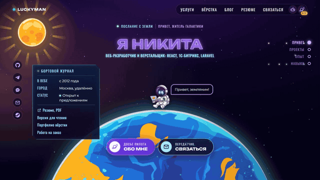

  

  

Чем занимаюсь:
- верстаю по Figma на своём сборщике: Pug, SCSS, esbuild, без jQuery;
- делаю интернет-магазины на 1С-Битрикс: свои модули на D7, обмен с 1С, скорость;
- пишу фронтенд на React и TypeScript, бэкенд на Laravel;
- поднимаю и обслуживаю серверы под сайты.

Мой пет-проект: [wishmarket.me](https://wishmarket.me/), сервис вишлистов. Делаем его втроём, вся разработка на мне: сайт на Laravel и React, Telegram-бот, расширение для Chrome и Firefox, мобильное приложение.

## LuckyStack

[LuckyStack](https://github.com/Leden4ik/luckystack) это мой установщик сервера хостинга на ISPConfig. Из чистого Debian или Ubuntu за один запуск получается сервер с nginx на HTTP/3, несколькими версиями PHP, MariaDB, почтой и защитой. После установки он остаётся на сервере: обновления, бэкапы и откат делаются командой `luckyctl` или из панели в ISPConfig, а уведомления приходят в Telegram.

Документация с примерами: [luckystack.luckyman.name](https://luckystack.luckyman.name)

## Залетай на орбиту

На [luckyman.name](https://luckyman.name/) космонавт сидит на планете. Его можно потрогать и бросить, планету раскрутить, в шапке спрятан «Звездопад», а по ~ открывается бортовой терминал. Проекты открываются посадкой на планету, а подробности о каждом лежат в отсеках космолёта.

  

На сайте 37 достижений за пасхалки из игр и мультиков нулевых. Пара загадок для разгона:
- Солнцу тоже нужен отдых. Настойчивость помогает.
- Вверх, вверх, вниз, вниз... дальше помнишь сам.
- В терминале лежит файл с расширением .nes.
- Любимая еда черепах-ниндзя, просто напиши её.

Застрял, в пульте у каждого достижения есть подсказка.

## Остальное

Все мои вёрстки со скриншотами, живыми сайтами и кодом: [luckyman.name/verstka](https://luckyman.name/verstka)  
Резюме: [luckyman.name/cv](https://luckyman.name/cv)

Здесь открыты LuckyStack, тестовые задания и мои инструменты. Коммерческий код закрыт, могу показать на созвоне.

Связаться: [Telegram](https://t.me/ManLucky) или hello@luckyman.name. Открыт к работе и подработке.
